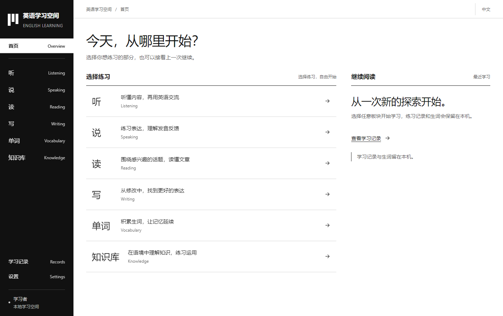
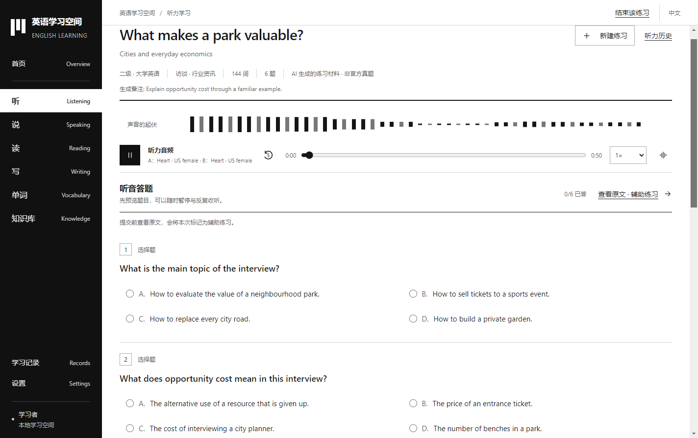
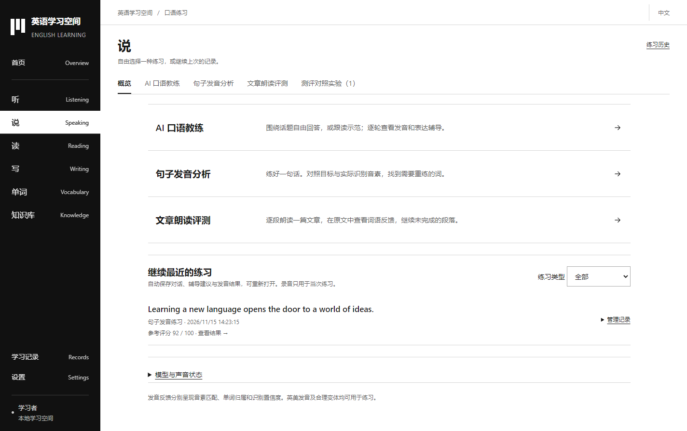
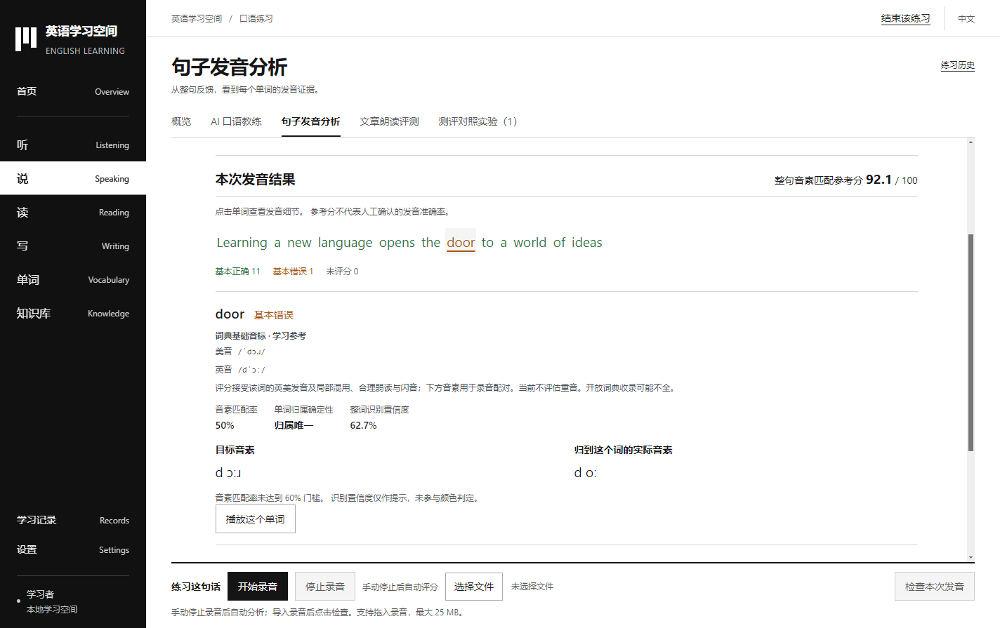
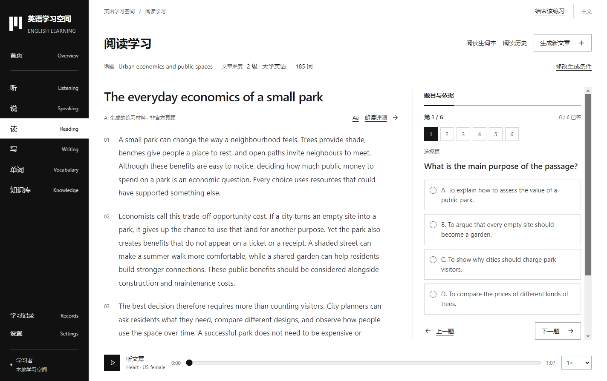
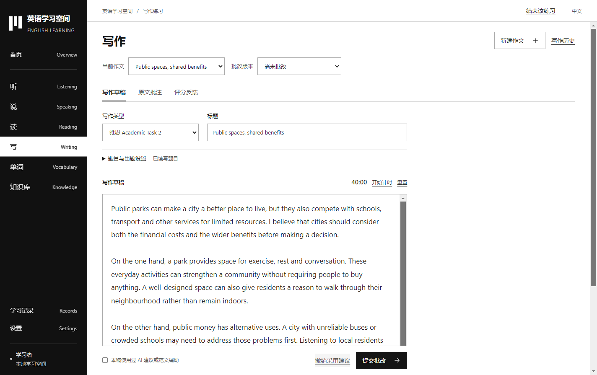
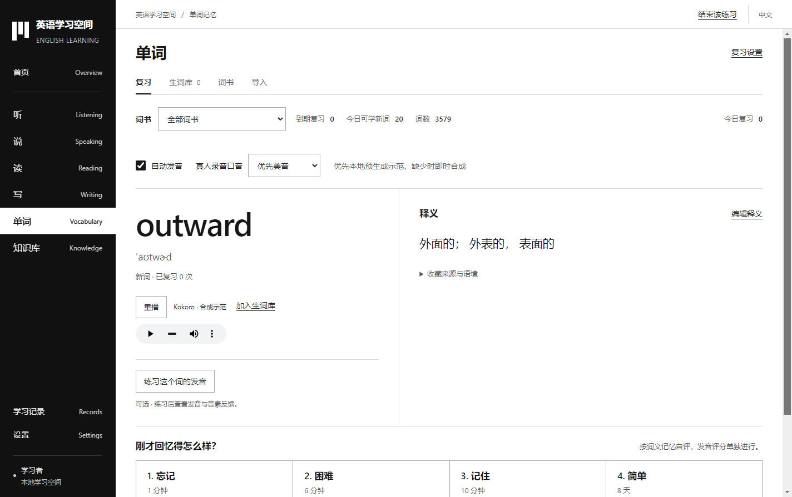

# 英语学习空间 · English Learning

**把你想了解的知识，变成适合自己的英语练习。**

英语学习空间是一款面向成人自主学习者的 AI 英语学习桌面应用。你可以围绕自己的兴趣、专业和生活话题练习听、说、读、写，积累生词与常用表达，并在反复练习中查看依据、理解反馈、继续改进。

项目以 Windows 桌面为主要运行方式，支持中文和 English 界面。本地语音服务负责识别、合成与发音反馈，语言生成和辅导通过用户自行配置的外部模型 API 完成。

> 当前处于开发阶段。源码、模型权重、运行环境和教学资源分别管理；从零安装流程及资源分发清单仍在完善。

**Windows 用户：[下载安装包](https://github.com/1441671379/ai-eng-test-learning/releases/tag/v0.3.1) · [简短安装与使用说明](docs/QUICKSTART.md)**

请下载发布页的三个安装 ZIP 文件并全部解压到同一个文件夹；`Source code` 和绿色 `Code → Download ZIP` 是开发源码，不是安装程序。

## 应用截图

以下为 v0.3.1 Windows 公开测试版的实际界面，使用独立演示账户与自编示例材料。口语结果来自合成示例音频的实际评估，仅展示反馈流程，不代表真实学习者成绩或评分准确率验证。



<details>
<summary>展开听、说、读、写与单词界面（6 张）</summary>

**听力：音频播放、声音可视化与答题。**



**口语概览：AI 口语教练、句子发音分析与文章朗读评测。**



**逐词发音反馈：整句参考分、单词判断及目标与实际识别音素。**



**阅读：原文与选择题并排展示，支持示范朗读和生词收藏。**



**写作：Task 2 草稿编辑、计时与本地保存；图中草稿尚未提交批改。**



**单词：翻面查看释义、记忆自评与可选发音练习。**



</details>

截图不包含个人记录或密钥；完整知识库来源课程包不随公开版提供。[截图索引与说明](docs/screenshots/README.md)

## 可以做什么

| 板块 | 功能 |
| --- | --- |
| 听 | 按话题、难度、长度和形式生成听力材料与题目；支持对话、访谈、科普和 Podcast，提供音频、答案依据、解析与听后交流。 |
| 说 | AI 口语教练、句子发音练习和文章朗读评测；查看逐词反馈、目标与实际识别音素，回听并重练。 |
| 读 | 按话题和难度生成文章与阅读题；查看答案依据、长难句解析和重点词汇，听示范朗读，或进入文章朗读练习。 |
| 写 | 逐句检查语法、用词与表达，定位原文中的问题；支持采纳或忽略建议、修改复评、版本历史及 IELTS 四项维度参考评分。 |
| 单词 | 跨板块收藏生词，通过单词卡与 FSRS 间隔复习持续巩固；支持词书、Anki 文本导入、手动编辑和单词发音练习。 |
| 知识库 | 按课程学习搭配与表达，结合情境阅读、用法讲解、英文回忆、填空、造句及可选 AI 点评。 |

六个板块可以自由选择。学习记录统一保存，生词可以逐步积累；知识库按课程记录阅读与练习进度，单词卡使用独立的间隔复习排程。

## 从一个话题开始

例如，你想用英语理解“通货膨胀如何影响日常生活”：

1. 在阅读中输入话题，选择适合自己的语言难度，生成文章与题目。
2. 答题后查看原文依据和长难句解析，把不熟悉的词加入生词库。
3. 点击“自己朗读这篇文章”，分段录音，查看逐词反馈并重练。
4. 回到单词板块复习生词，也可以围绕这个话题另行进行听力、口语或写作练习。

你可以从需要的板块开始，也可以只专注于其中一种练习。

## 本地能力与外部模型

| 内容 | 当前运行方式 |
| --- | --- |
| 学习记录、复习进度和应用设置 | 保存在本机。 |
| 语音识别、英文单词时间定位和发音评估 | 使用本地语音模型处理。 |
| 示范朗读和对话音频 | 统一使用本地 Kokoro 合成；单词按需生成并缓存，独立词典索引保留多读法选择。 |
| 材料生成、写作批改、对话辅导和可选 AI 点评 | 调用用户在设置中配置的外部语言模型 API。 |
| 界面语言切换 | 使用随应用打包的中英文词表。 |

当前桌面方案不携带本地大语言模型。用户可以配置模型服务地址、模型名和自己的 API Key，相关调用费用由所选服务商按其规则收取。

**本地保存不等于所有内容都留在本机。** 使用生成、批改或辅导功能时，文章、作文、对话、录音转写等相关文字会按功能需要发送至用户选定的外部服务。独立的第三方口语测评对照实验会提交录音，其数据流见[实验说明](deployment/tencent-soe/README.md)。

发音与写作评分用于学习参考，尚未校准为官方考试成绩。AI 材料、释义和课程讲解可能存在错误，需要结合上下文核对。

## 使用

### 已构建的 Windows 桌面版

如果你拿到的是完整 Windows 测试安装包：

1. 保留安装目录中的外层 `Setup.exe`、`files` 和 `prerequisites`，运行外层安装程序。
2. 打开应用，在设置中配置语言模型服务地址、模型名和 API Key。
3. 进入需要的学习板块；进行发音练习时允许麦克风访问，录音结束后查看反馈。

如果开发工作区已经组装桌面目录，可双击根目录的 `Start-Desktop.cmd`，或运行：

```powershell
.\Start-Desktop.cmd
```

该入口依赖已存在的 `deployment/electron/build/EnglishLearning/EnglishLearning.exe`，不会自动下载模型或完成首次构建。

现有桌面方案携带语音模型和 Python/PyTorch 环境，需要为本地推理及模型文件预留资源。最低硬件要求、不同 GPU 和纯 CPU 下的体验仍需进一步验证。当前以 Windows 为主要验证平台，仓库中的其他平台代码不代表已完成对应发布。

桌面学习数据保存在 `%APPDATA%/EnglishLearningDesktop`；开发环境数据保存在 `deployment/learning-data`，两者分别管理。安装与构建细节见[桌面说明](deployment/electron/README.md)。

### 已有本地开发环境

以下命令适用于已经准备好本项目运行环境的开发者，**尚不是全新电脑上的一键安装流程**。

需要先准备：

- Node.js 24 与 pnpm；应用使用 Node 内置 SQLite。
- `runtimes/inference-kokoro` 下的公共 Python 环境，以及 `models` 下所需的语音权重。
- Kokoro 模型、四种英语音色和 `deployment/kokoro/settings.json` 中的本地配置。
- 所需词典、词书和课程资源，分别遵守其来源许可。
- 本项目自有的 Kokoro 适配代码，无需另一个项目的能力库。

公共服务与环境布局见[服务说明](services/README.md)。仅安装前端依赖不会准备 Python 环境、模型及资源。

在项目根目录运行：

```powershell
pnpm --dir apps/web install
.\Start-LearningApps.ps1
```

打开 [本地学习首页](http://127.0.0.1:3000/dashboard)。首次进入会建立本地学习身份；使用外部模型前需完成设置。

停止应用：

```powershell
.\Stop-LearningApps.ps1
```

仅重启网页、保留已加载的语音模型：

```powershell
.\Stop-LearningApps.ps1 -App web
.\Start-LearningApps.ps1 -App web
```

## 开发与构建

主要技术包括 Next.js、React、TypeScript、Electron、Python、PyTorch 和 SQLite；单词复习使用 `ts-fsrs`。

前端检查与构建，在项目根目录运行：

```powershell
pnpm --dir apps/web typecheck
pnpm --dir apps/web test
pnpm --dir apps/web build
```

在已有桌面构建与推理环境中，运行 `Start-DesktopDev.cmd`，可在 Electron 内开发同一套界面并实时刷新。

关闭桌面窗口后，更新生产界面与服务：

```powershell
.\Build-Desktop.ps1 -RefreshUI
```

在已准备桌面构建环境和模型的工作区，运行 `Build-Desktop.ps1` 组装应用目录，再运行 `Build-Installer.ps1` 封装安装程序。完整依赖和流程见[桌面构建说明](deployment/electron/README.md)。

## 项目结构

| 目录 | 职责 |
| --- | --- |
| `apps/web` | 六个学习板块、公共界面、设置与学习记录。 |
| `apps/desktop/windows` | 当前 Windows Electron 外壳。 |
| `services/speech` | 语音识别、音素反馈、英文单词时间定位和 TTS 适配。 |
| `services/language` | 语言模型访问、材料生成、写作批改和学习辅导。 |
| `services/common`、`services/data` | 公共适配与语音练习基础数据。 |
| `deployment` | 构建脚本、资源说明与环境配置。 |
| `docs` | 产品功能、开发记录与项目介绍。 |
| `apps/mobile` | 保留的上游兼容工程，当前不承载主要学习界面。 |

模型和运行环境分别位于 `models`、`runtimes`，不随普通源码下载自动准备。

## 参与改进

欢迎通过 Issue 或 Pull Request 帮助改进：

- Windows 安装、模型配置与从零启动流程。
- 真实学习场景中的发音反馈、生成题目和写作批改质量。
- 课程与词汇内容核对、中英文界面文案和可访问性。
- 推理性能、运行稳定性、错误恢复及开发文档。

报告问题时，请说明复现步骤、应用版本、系统与硬件环境，并按需要提供去除个人信息的日志。提交代码前运行与改动相关的检查；不要提交 API Key、私人录音、学习数据库或授权不明的资源。

## 许可与致谢

当前前端与部分服务保留 Cadence 上游的 MIT 版权及许可声明。根目录统一的应用代码许可证尚待确定；本 README 不为第三方代码、模型或资料授予新的许可。

不同资源采用各自的许可与使用条件：

- [前端上游 MIT 声明](apps/web/LICENSE)与[语音服务上游 MIT 声明](services/speech/LICENSE.cadence)。
- [音标词表来源与许可](services/speech/data/ipa-dict/ATTRIBUTION.md)：美式与英式数据分别包含 MIT、GPL-3.0 许可要求。
- [搭配与表达资料说明](deployment/phrases/NOTICE.md)：区分来源词表、项目教学内容与 AI 生成内容。
- [桌面组件与资源说明](deployment/electron/THIRD_PARTY_NOTICES.md)：记录模型、音色、词书和其他组件的来源与分发边界。

角色音色、参考录音、用户导入词书和部分来源词表的再分发授权仍需单独核对，当前本机可用不代表它们均可随公开版本发布。

感谢 Cadence、Whisper、wav2vec2 / torchaudio、Kokoro / Misaki、ECDICT、ipa-dict、ts-fsrs 等上游项目与数据贡献者。本项目在相关开源能力基础上进行学习流程整合、界面重构与功能开发。

## 更多说明

- [产品定位与已确认的功能边界](PRODUCT.md)
- [界面设计规范](DESIGN.md)
- [公开资源与准备方式](docs/PUBLIC-RESOURCES.md)
- [公共词典准备](deployment/dictionary/README.md)
- [Kokoro 语音服务与本地缓存](deployment/kokoro/README.md)
- [公共服务架构](services/README.md)
- [GitHub 简介与项目介绍文案](docs/GITHUB-INTRO.md)
